# How to use FUSE

Start on the [official FUSE website](https://fuseprotocol.org/). You can see published results without signing in. Use **My account** only when you want to see your own balances, top up, or request a withdrawal.

[Sign in](how-to-use-fuse.md#open-fuse-and-sign-in) · [Top up](how-to-use-fuse.md#fund-your-account-and-top-up) · [Find results and payouts](how-to-use-fuse.md#find-the-round-result-and-your-payouts) · [Withdraw](how-to-use-fuse.md#request-and-track-a-withdrawal)


The public screens below are cropped screenshots. The signed-in payment screens are labeled illustrations: they contain no real account or transaction data.


## Open FUSE and sign in



### Open the official website

Go to [fuseprotocol.org](https://fuseprotocol.org/), check the address, and select **Open the application**. The app opens separately at `app.fuseprotocol.org`.

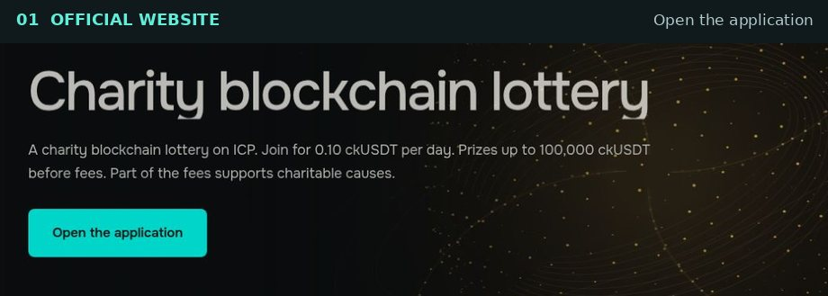



### Open My account

In the app's top bar, select **My account**. To return later, use the [same official account page](https://app.fuseprotocol.org/account). If needed, set the language to English to match this guide.

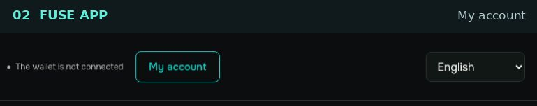



### Open the sign-in chooser

Select **Select a login method**. The panel lists **OISY** and **Internet Identity**. Do not enter a private key or recovery phrase on FUSE.

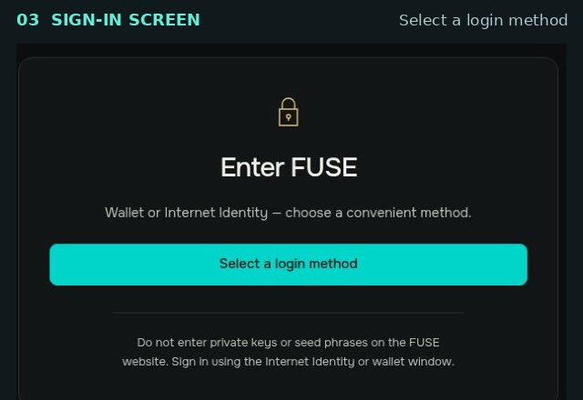



### Finish signing in with the right account



1. Choose **OISY** in the FUSE panel. The wallet opens in a separate window. If you do not see it, check for a browser popup notice and return to the FUSE tab.
2. Unlock or open the wallet there. If OISY asks for Internet Identity, finish that sign-in **inside the OISY flow**, then return to OISY.
3. Review the requesting site and requested permissions before approving. If several accounts are shown, choose the same ICP account you use for FUSE and ckUSDT.
4. Return to FUSE. **In your wallet** should now show data for the selected account. Connecting is not a top-up; a later transfer has a separate confirmation.

See [OISY's guide to connecting to ICP apps](https://docs.oisy.com/using-oisy-wallet/how-tos/connecting-to-dapps).



1. Choose **Internet Identity** in the FUSE panel. In the separate Internet Identity window, select the identity you intend to use and authenticate with its passkey. If you are new, use the provider's account creation option and then return to FUSE.
2. Review the destination and authorize only the expected FUSE site. Return to FUSE and check that **Personal account** now shows your balances.
3. If you previously added this Identity under **Login methods**, it opens the linked wallet-based FUSE account. If you use a standalone Identity, return using the same Identity and the same FUSE site. An unlinked Identity does not open your wallet-based account.

If the balance or history looks unfamiliar, switch back to the account you originally used. Separate existing accounts are not merged.



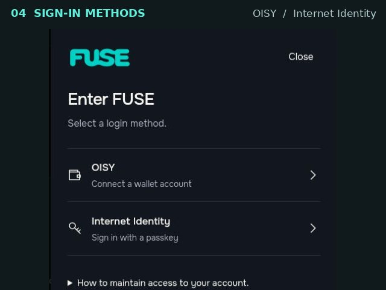



## Fund your account and top up



### Check the source balance

Look at **In your wallet** before topping up. You need **ckUSDT on the Internet Computer (ICP)** in the account you selected, plus enough to cover the ledger fee.

* **OISY:** check the balance in the chosen ICP wallet account. If it is empty, use that account's ckUSDT receiving address in OISY to fund it.
* **Standalone Internet Identity:** use the ckUSDT receiving account shown for your signed-in ID in FUSE. Do not use a different wallet address by mistake. After funding, return to FUSE and select **Refresh** if needed.
* Do not send USDT from another network to this address or send to the FUSE canister manually. A transfer into your own wallet or ID balance is **not** a FUSE top-up.

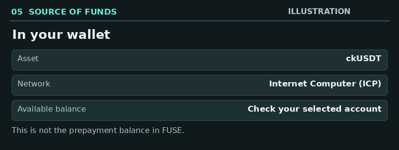



### Enter the participation amount

Under **Your contribution to the protocol**, select a preset or enter **Other amount**, then select **Top up the protocol**. Participation costs **0.1 ckUSDT per day**; the ledger fee is extra. Prepayment is non-refundable and does not guarantee a win.

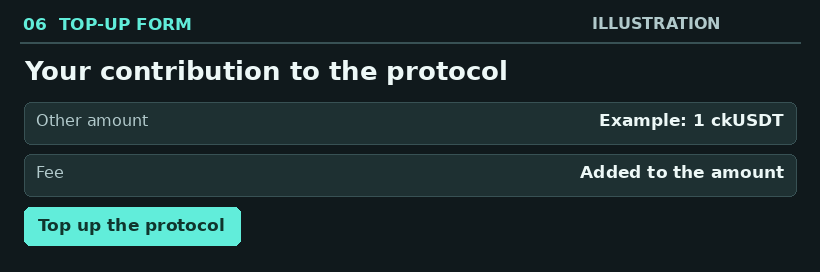



### Review and confirm the top-up

Check the sender, FUSE recipient, network, token, amount, fee and total. If they match, select **Confirm top-up**. If you signed in with OISY, review and approve the same transfer in the wallet window.

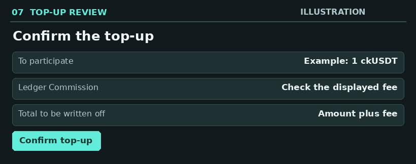



### Verify that the prepayment was credited

Return to **My account** and check **Your contribution to the protocol** and the participation days shown there. A ledger confirmation does not always mean that FUSE has credited the prepayment yet. If the result is uncertain or the wallet closed after confirmation, use **Check top-up** when offered. Do not start a second transfer to test the first one. See the [participation terms](https://app.fuseprotocol.org/terms) for timing and conditions.

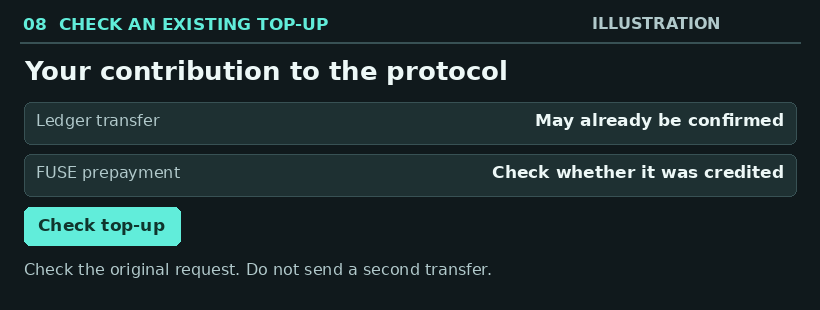



## Find the round result and your payouts



### Public results: see how the round ended

In the app, select [Distribution results](https://app.fuseprotocol.org/app#tour-section). **Latest completed round** shows the published result. Open **Winners and details of the draw** for more detail, or choose an older round under **Rounds and payments**. This page is public; the forecast above it is not a completed result.

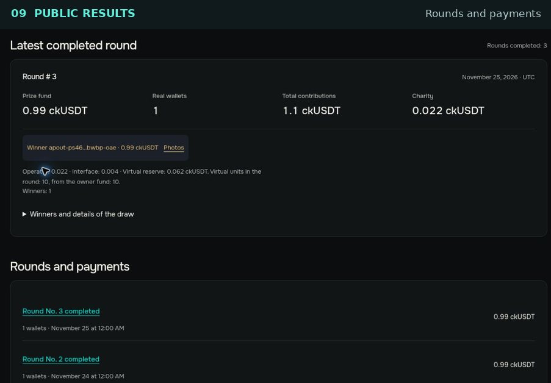



### Personal payouts: find your own transfers

Go back to [My account](https://app.fuseprotocol.org/account) and sign in with the same account. **It is possible to withdraw** shows what you can request now. Scroll **below the withdrawal form** to **My payments**. That is your personal withdrawal history, not the public archive.

A published win can increase your withdrawable balance before any transfer exists. If you have not requested a withdrawal, an empty **My payments** list does not mean the winnings are missing.

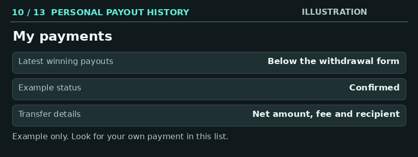



## Request and track a withdrawal



### Choose the destination and withdrawal amount

Under **It is possible to withdraw**, choose **To my account** or **To another recipient**. For another recipient, use the ckUSDT receiving address on ICP copied from the receiving wallet; verify any subaccount. Enter **Withdrawal amount with commission**, then select **Check the terms and conditions**. This opens a review, not a payment.

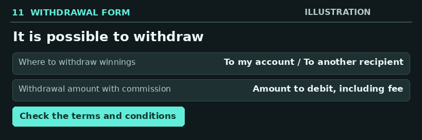



### Review the fee and the net amount

In **Review withdrawal**, verify **Recipient**, **Commission**, and **The addressee will receive it**. The recipient receives the entered amount minus the fee. If something does not match, cancel rather than confirm. When correct, select **Confirm the withdrawal**.

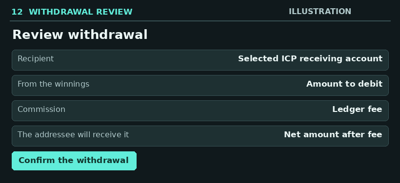



### Confirm the outcome in My payments

On the same **My account** page, scroll back to **My payments**. Find your request by its payment number. The row shows the status, net amount, fee and recipient when available.

| Status you may see                                                      | What to do                                                                                      |
| ----------------------------------------------------------------------- | ----------------------------------------------------------------------------------------------- |
| **Confirmed**                                                           | Check the receiving account. The transfer is confirmed.                                         |
| **Awaiting confirmation** or **Undetermined response · funds reserved** | Use **Check payment** when offered to check the same request. Do not start a second withdrawal. |
| **Not sent**                                                            | Review the outcome and your available balance before attempting anything new.                   |

For a payout to a standalone Internet Identity account, **Send from account Internet Identity** is a separate action for tokens already on that account. It is not a second withdrawal from FUSE. If a payment is still unclear, keep the payment number and contact [FUSE support](mailto:support@fuseprotocol.org). Do not send recovery phrases or private keys.


