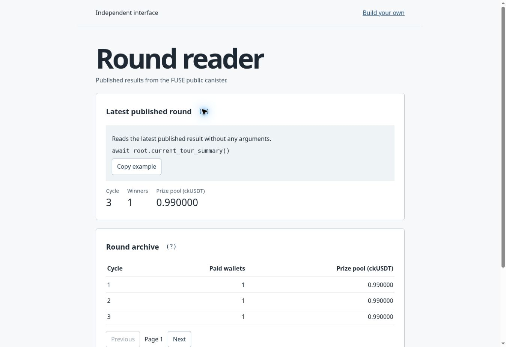

# How to earn with FUSE

Want to cover FUSE on your channel or show results on your own website? You can start without connecting a wallet, paying a deposit, or building a new lottery. See the [official FUSE website](https://fuseprotocol.org/) and [open the live example](https://rounds.fuseprotocol.org/).

Already have a website? [Embed the FUSE widget](build-an-interface/results-widget.md) to show the latest result with one HTML snippet. No custom development or FUSE registration is required if your site allows embeds.

## Pick what you want to do

| What you want                                        | What it takes                                                                                                                                                                                                                                                                                                                            |
| ---------------------------------------------------- | ---------------------------------------------------------------------------------------------------------------------------------------------------------------------------------------------------------------------------------------------------------------------------------------------------------------------------------------- |
| **Cover FUSE in a video, post, or newsletter**       | Share the [live demo](https://rounds.fuseprotocol.org/) or [official results](https://app.fuseprotocol.org/app#tour-section). No website, registration, or wallet is needed.                                                                                                                                                             |
| **Put results on your own website**                  | Ask a web developer to adapt the [Round Reader example](https://github.com/fusefoundation/fuse-interface-kit/tree/main/examples/round-reader). Start with one page in your own style: the latest completed round and the archive. Public data needs no FUSE registration or bond. Your own development and hosting may still cost money. |
| **Run a registered interface under your own domain** | This is a separate step. You need an HTTPS website, a developer to integrate and test the payment flow, domain verification, and a **100 ckUSDT refundable bond** subject to [the rules](costs.md).                                                                                                                                      |

## Copy this brief for your developer

> Build one mobile-friendly page on my website using the FUSE Round Reader source. Show the latest published round and an archive. Label FUSE as the data source, and display when data was last fetched. If the data is unavailable, show a retry option instead of fake results. I want a public preview link and simple setup instructions. No login, wallet connection, or payments in this first version.

Send them the [source with setup instructions](https://github.com/fusefoundation/fuse-interface-kit/tree/main/examples/round-reader), the [developer quick start](quickstart.md), and the [live example](https://rounds.fuseprotocol.org/). You can judge the result yourself: open the link on your phone and compare the latest round with the official results.

## How the operator share works

Sharing a link or displaying results does **not** earn an operator share. On an active, registered interface, the share is **40% of the protocol fee** on eligible daily contributions attributed to that interface, not 40% of deposits. A top-up alone does not earn it, and earnings are not guaranteed. See [operator earnings](earnings.md) and [how to register your website](register.md).

For viewers who want to learn how the official app works, share [How to use FUSE](how-to-use-fuse.md). For a partnership question, contact [FUSE partnerships](mailto:partners@fuseprotocol.org).
