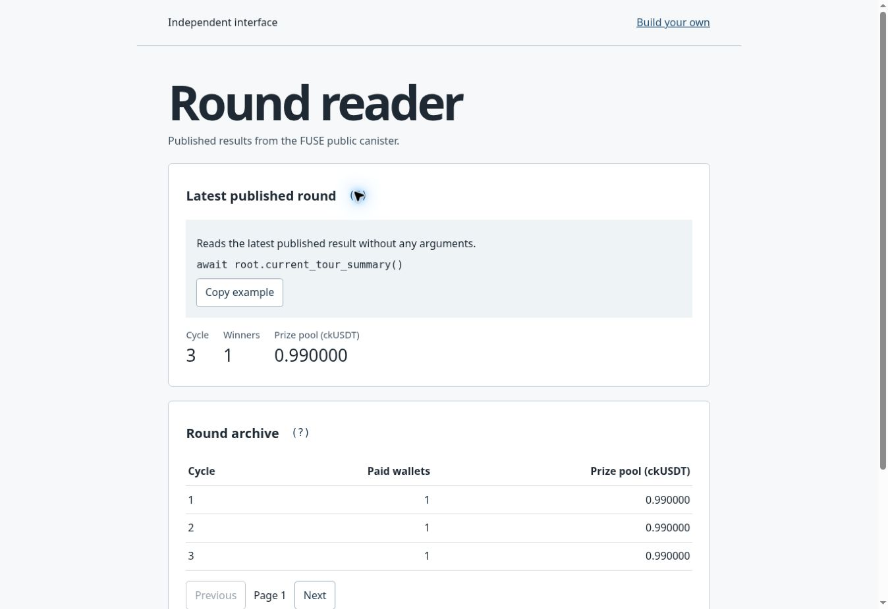

# Quick start

Build a page that shows live FUSE results. Open the working example first, then run the same code on your machine.

<a href="https://rounds.fuseprotocol.org/" class="button primary">Open live demo</a> <a href="quickstart.md#run-locally" class="button secondary">Run locally</a>

In **Latest published round**, look for **Cycle**. In **Archive**, use the paging controls to see older rounds. Compare the same cycle with the [official FUSE results](https://app.fuseprotocol.org/app#tour-section). The `?` next to each section shows the request and its arguments. A forecast is not a published result.



## Run locally

Install Node.js 22 or later, npm, Git, and Python 3. Open a terminal and run:

```bash
git clone --branch v1.0.0 --depth 1 https://github.com/fusefoundation/fuse-interface-kit.git
cd fuse-interface-kit
npm ci
node examples/round-reader/build.mjs
python3 -m http.server 8000 --bind 127.0.0.1 --directory examples/round-reader/dist
```

Open [http://127.0.0.1:8000](http://127.0.0.1:8000). You should see the results and archive from ICP mainnet. To check the same data from a terminal, run `npm run rounds` in a second terminal from the repository root. Look for `published.cycle_id` in the JSON. If no round is published yet, `published` is `null`.

## Hello World: read one round

Run this from the repository root. It prints the cycle ID of the latest published round, or a message if no result exists.

```bash
node --input-type=module <<'JS'
import { rootActor, unwrap } from './examples/fuse.mjs';

const root = rootActor();
const summary = unwrap(await root.current_tour_summary());
const [round] = summary.latest_tour;
console.log(round ? `Published cycle: ${round.cycle_id}` : 'No published round yet.');
JS
```

Your site reads results from **FUSE Root**. The example does not connect a wallet, send transfers, or store credentials. See the [read-only API](api.md) for other public queries.

## Choose what to ship

| Goal                                                  | Next step                                                                                                                                                                                                                   |
| ----------------------------------------------------- | --------------------------------------------------------------------------------------------------------------------------------------------------------------------------------------------------------------------------- |
| Publish results only                                  | Upload the **contents** of `examples/round-reader/dist/` to an HTTPS static host. Open the deployed page as a guest and compare its cycle with the official results. No registration, bond, or separate canister is needed. |
| Accept attributed deposits through your own interface | Start with [Register your website](register.md), then follow the wallet integration and test the full payment and recovery flow outside mainnet.                                                                            |
